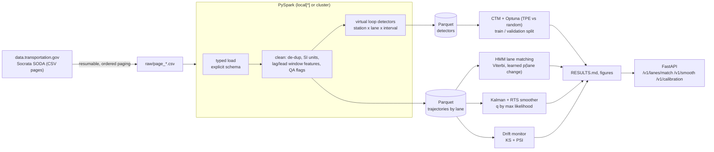
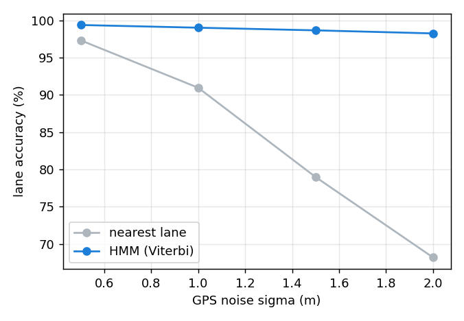
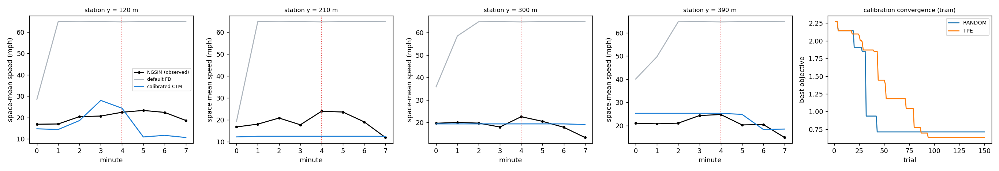

# cloud-trajectory-etl-geh-pipeline

**Real USDOT NGSIM trajectories → calibrated traffic model.** A PySpark ETL ingests the public
NGSIM I-80 data (703,742 rows, 1,314 vehicles, 10 min), builds virtual loop detectors, and
feeds four analytics stages: lane-level HMM map matching of GPS-degraded probes,
Kalman/RTS speed reconstruction, Optuna calibration of a cell transmission model scored with
FHWA GEH and speed error, and KS/PSI drift monitoring.

**Headline:**

* **Lane matching:** at 2 m GPS noise, nearest-lane matching identifies the correct lane for **68%** of
  points; the HMM keeps **98.3%**, and reports 197 lane changes against 171 real ones (nearest-lane: 9,257).
* **Calibration:** CTM speed error fell from **20.1 to 3.0 m/s** on held-out minutes. On window totals the
  *uncalibrated* model also passes GEH at 100%, which shows why GEH alone cannot validate a model.

---

## 1. Problem formulation

Agencies calibrate simulation models against detector counts (GEH) and speeds, and
increasingly use probe trajectories. Three practical problems sit between raw trajectories
and a calibrated model:

1. **Scale and quality.** Trajectory feeds are large and noisy (NGSIM is a well-known example of
   measurement noise in video-extracted positions). Cleaning has to be distributed and auditable.
2. **Probe positioning error.** Consumer GPS (1-5 m) is comparable to a 3.7-m lane width, so the
   naive nearest-lane assignment fails.
3. **Calibration that means something.** Matching volumes is necessary but not sufficient. FHWA's
   Traffic Analysis Toolbox Vol. III calls for volumes **and** speeds/travel times, validated on data
   not used for fitting.

| Bar | What this repo does |
|---|---|
| **Traffic engineering** | Virtual detectors, CTM with on-ramp and congested boundary conditions, GEH (FHWA), held-out validation |
| **ML / data** | PySpark window-function ETL, HMM with an MLE-learned transition model, Kalman/RTS with likelihood-tuned process noise, Optuna TPE vs. random search, KS + PSI drift detection |
| **Systems** | Resumable paginated ingestion from a public API, Parquet with partitioning, FastAPI for online lane matching and smoothing, Docker |

**Data.** NGSIM *Vehicle Trajectories and Supporting Data*, US DOT, data.transportation.gov
(dataset `8ect-6jqj`, public domain): I-80 in Emeryville, CA, 13 April 2005, 4:00-4:10 pm,
about 500 m with six mainline lanes and the Powell St on-ramp auxiliary lane (lane 7). The raw data
is not committed; `trajetl download` fetches it (75 MB, 15 pages, resumable).

---

## 2. Architecture



---

## 3. Methodology

### 3.1 ETL (PySpark)
De-duplication on (vehicle, frame); ft → m, ft/s → m/s; time relative to the window start;
per-vehicle `lag` features give finite-difference speed and acceleration. Rows with
|a| > 10 m/s² are flagged, not dropped (**27,834 rows, 4.0%**). This is the known NGSIM noise
signature, and dropping them would bias the detectors. The public extract for this window contained
**no duplicate rows** (the check still runs). A **virtual detector** records a crossing when
$y_{t-1} < y_s \le y_t$. Space-mean speed is $\bar v_s = n / \sum_i 1/v_i$.

> Windows note: Spark's own Parquet writer needs Hadoop `winutils.exe`. On Windows the tables are
> collected through Arrow and written with pyarrow (same layout); on Linux/Docker Spark writes directly.
> Spark ETL took 39 s for 703k rows on a 4-core laptop with `local[2]`.

### 3.2 Lane-level HMM map matching
Hidden state = lane; emission $p(x\mid \ell)=\mathcal N(x;\,c_\ell,\sigma^2)$, with lane centres $c_\ell$ estimated
from training vehicles. Transitions: stay $1-p$, adjacent $p/2$, otherwise $\varepsilon$, with
$\hat p = 0.0087$ per 1-s observation (MLE on training vehicles). Lane availability masks lane 7
outside its extent. Decoding uses log-space Viterbi, $O(TL^2)$. Evaluation: 30% of vehicles held out (by
hashed vehicle id), resampled to 1 Hz, with Gaussian noise added; ground truth is NGSIM's lane id.

### 3.3 Kalman / RTS smoothing
Constant-acceleration state $[y, v, a]$ with white-noise jerk density $q$:

$$F=\begin{bmatrix}1&\Delta t&\tfrac{\Delta t^2}{2}\\0&1&\Delta t\\0&0&1\end{bmatrix},\quad
Q=q\begin{bmatrix}\tfrac{\Delta t^5}{20}&\tfrac{\Delta t^4}{8}&\tfrac{\Delta t^3}{6}\\\tfrac{\Delta t^4}{8}&\tfrac{\Delta t^3}{3}&\tfrac{\Delta t^2}{2}\\\tfrac{\Delta t^3}{6}&\tfrac{\Delta t^2}{2}&\Delta t\end{bmatrix}$$

$q$ is chosen by innovation log-likelihood on separate tuning vehicles, then the Rauch-Tung-Striebel
backward pass smooths.

### 3.4 CTM calibration and GEH
Daganzo CTM with a triangular fundamental diagram per lane ($v_f$, $w$, $k_j$, capacity factor), and 30-m
cells with lanes per cell measured from where vehicles drive (6-6-6-7-7-7-7-6-...). All boundaries come
from data: upstream counts, **on-ramp entries** (vehicles first seen in lane 7), **initial cell densities**,
and a **congested downstream supply** $\min(q_{max}N,\;w(k_jN-k_{obs}))$.

Objective on the training minutes:

$$J=\frac{\overline{\text{RMSE}}_v}{10\text{ m/s}}+0.1\,\overline{\text{GEH}},\qquad
\text{GEH}=\sqrt{\frac{2(M-C)^2}{M+C}}\ \ (\text{hourly rates})$$

Optuna TPE vs. random search, 150 trials each. Validation is on the later, unseen minutes.

### 3.5 Drift monitoring
Speeds in 30-s windows vs. the first 2 minutes: two-sample KS (Bonferroni-corrected) **and**
PSI > 0.25 must both fire, which suppresses sample-size-only alarms.

---

## 4. Results (full report: [`results/i80_1600/RESULTS.md`](results/i80_1600/RESULTS.md))

### 4.1 Lane-level map matching (20,477 held-out 1-Hz probe points, 1 Hz)

| GPS noise σ | Nearest lane | **HMM** | Lane changes: true / nearest / HMM | Decode |
|---|---|---|---|---|
| 0.5 m | 97.3% | **99.4%** | 171 / 681 / 182 | 1.6 ms/veh |
| 1.0 m | 91.0% | **99.0%** | 171 / 2,954 / 188 | 1.2 ms/veh |
| 1.5 m | 79.0% | **98.7%** | 171 / 6,668 / 195 | 1.8 ms/veh |
| 2.0 m | 68.2% | **98.3%** | 171 / 9,257 / 197 | 1.9 ms/veh |



Nearest-lane assignment does not only lose accuracy: it generates thousands of false lane
changes, which would corrupt any lane-change or weaving analysis built on probe data.

### 4.2 Speed reconstruction (240 held-out vehicles, 1 Hz, σ = 1 m)

| Estimator | Speed RMSE vs. NGSIM |
|---|---|
| Finite difference | 0.99 m/s |
| Kalman filter (causal, real-time) | 1.28 m/s |
| **RTS smoother (offline)** | **0.86 m/s** |

The causal filter is *worse* than finite differences: it lags in stop-and-go traffic. The backward RTS pass
removes the lag, cutting error 13%. The real-time and offline use cases need different estimators.

### 4.3 CTM calibration

| | Default (HCM-like) | Calibrated (TPE) |
|---|---|---|
| Free-flow speed | 29.0 m/s | 23.0 m/s |
| Congestion wave speed $w$ | 5.4 m/s | **3.7 m/s (13 km/h)** |
| Jam density | 0.125 veh/m/lane | 0.145 veh/m/lane (233 veh/mi/lane) |
| Capacity | 2,049 vphpl | **1,351 vphpl** |

| Model | Split | Speed RMSE | 1-min GEH < 5 | Stations GEH < 5 (window totals) |
|---|---|---|---|---|
| Default | validation | 20.1 m/s | 69% | 100% |
| **Calibrated** | train | **1.9 m/s** | 81% | 100% |
| **Calibrated** | validation | **3.0 m/s** | 44% | 100% |



**Reading it as an engineer:**

* The calibrated values are physically credible for a congested freeway: the backward wave of about
  13 km/h and the queue-discharge rate of about 1,350 vphpl reflect the capacity drop. The default parameters
  predict 65-mph free flow on a road that is moving at 15-25 mph.
* **GEH on totals cannot tell the two models apart** (both 100%), because conservation and the boundary
  counts pin volumes. Only speeds expose the difference, which is the case for calibrating on both.
* **The model does not meet 1-minute GEH on validation (44% < 85%).** A first-order CTM holds discharge at
  capacity and cannot reproduce I-80's stop-and-go oscillations. Closing that gap needs a second-order
  (ARZ) or microscopic model. That limitation is reported here rather than tuned away.
* TPE ends with a better objective than random search (0.63 vs 0.71), although random search led early.
  With 4 parameters the advantage is modest.

### 4.4 Drift
Reference median speed 7.1 m/s (congested). **10 of 16** 30-s windows are flagged, the first at
t = 120 s. These are the stop-and-go waves: the regime is not stationary, even within 10 minutes, which
is another reason a single static fundamental diagram underfits it.

---

## 5. Repository layout

```
src/trajetl/
  ingest/ngsim.py          resumable Socrata download
  spark/etl.py             schema, clean, QA report, virtual detectors, Parquet writer
  mapmatch/hmm.py          lane map, HMM, Viterbi, probe degradation
  smoothing/kalman.py      CA Kalman filter, RTS smoother, likelihood tuning
  calibration/ctm.py       CTM with ramp + boundary conditions, GEH
  calibration/optimize.py  Optuna objective, train/validation evaluation
  monitoring/drift.py      KS + PSI monitor
  pipeline.py, report.py, cli.py, api/app.py
tests/                     11 tests (incl. a real local Spark job on an NGSIM-format fixture)
```

## 6. Reproduce

```bash
python -m venv .venv && .venv/Scripts/activate      # Python 3.11 (PySpark 3.5 does not support 3.12)
pip install -r requirements.txt && pip install --no-deps -e .
pytest                                              # needs Java 17 for the Spark test
trajetl download --minutes 10                       # ~75 MB from data.transportation.gov
trajetl run --trials 150                            # ~1 min on a laptop
trajetl serve --port 8000
docker build -f docker/Dockerfile -t trajetl . && docker run --rm -v %cd%/data:/app/data trajetl run
```

## 7. Limitations

* 10 minutes of one site, so the held-out validation is the following 4 minutes of the same day.
  Cross-day transfer (the 5:00-5:30 pm periods) is the natural next test.
* Probe noise is synthetic (Gaussian, independent); real GNSS error is correlated (multipath),
  which would favour higher HMM stickiness.
* NGSIM's own speeds are noisy, so "ground truth" errors include NGSIM error.

## License

MIT. NGSIM data: US DOT, public domain.
