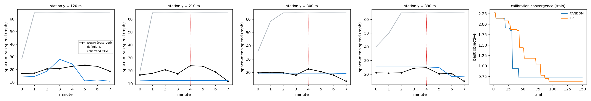
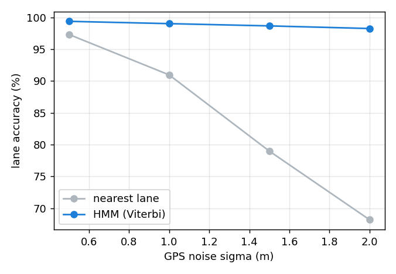

# Pipeline results: NGSIM I-80, 4:00 pm window

## Data and ETL quality

| Item | Value |
|---|---|
| Raw rows downloaded | 703,742 |
| Duplicate (vehicle, frame) rows removed | 0 |
| Clean rows | 703,742 |
| Vehicles | 1,314 |
| Rows with implausible finite-difference acceleration (>10 m/s²) | 27,834 |
| Rows moving backwards (> 0.5 m/s) | 0 |
| Duration covered | 10.0 min |
| Lanes | [1, 2, 3, 4, 5, 6, 7] |

## Lane-level map matching (held-out 30% of vehicles, 1 Hz probes)

Lane-change probability per observation learned on the training vehicles: 0.0087.

| GPS sigma | Points | Nearest-lane accuracy | HMM accuracy | True lane changes | Nearest-lane changes | HMM changes | Decode time |
|---|---|---|---|---|---|---|---|
| 0.5 m | 20,477 | 97.3% | 99.4% | 171 | 681 | 182 | 1.05 ms/veh |
| 1.0 m | 20,477 | 91.0% | 99.0% | 171 | 2954 | 188 | 0.92 ms/veh |
| 1.5 m | 20,477 | 79.0% | 98.7% | 171 | 6668 | 195 | 0.80 ms/veh |
| 2.0 m | 20,477 | 68.2% | 98.3% | 171 | 9257 | 197 | 0.77 ms/veh |

## Speed reconstruction (240 held-out vehicles, 1 Hz, sigma 1.0 m)

Jerk spectral density q = 0.1 selected by innovation log-likelihood on separate tuning vehicles.

| Estimator | Speed RMSE vs NGSIM speed |
|---|---|
| Finite difference | 0.99 m/s |
| Kalman filter (causal) | 1.28 m/s |
| RTS smoother | 0.86 m/s |

## CTM calibration (train = first half, validation = second half of the window)

Stations [30.0, 120.0, 210.0, 300.0, 390.0, 450.0] m, 60-s intervals (8 intervals). Lanes per 30-m cell: [6, 6, 6, 7, 7, 7, 7, 6, 6, 6, 6, 6, 6, 6, 6, 6]. Best sampler: **TPE**.

| Parameter | Default (HCM-like) | Calibrated |
|---|---|---|
| Free-flow speed vf | 29.0 m/s | 23.0 m/s |
| Wave speed w | 5.4 m/s | 3.71 m/s |
| Jam density kj | 0.125 veh/m/lane | 0.145 veh/m/lane |
| Capacity factor | 1.00 | 0.81 |
| Capacity q_max | 2049 vphpl | 1351 vphpl |

| Model | Split | Speed RMSE | Mean GEH (1-min rates) | 1-min intervals GEH < 5 | Stations GEH < 5 (window totals) |
|---|---|---|---|---|---|
| Default FD | train | 17.11 m/s (38.3 mph) | 10.18 | 62% | 50% |
| Default FD | validation | 20.11 m/s (45.0 mph) | 5.42 | 69% | 100% |
| Calibrated | train | 1.86 m/s (4.2 mph) | 4.48 | 81% | 100% |
| Calibrated | validation | 3.00 m/s (6.7 mph) | 6.54 | 44% | 100% |

Best training objective after 150 trials: TPE 0.6340, random 0.7136.

## Drift monitoring (speeds at y = 200-260 m, 30-s windows vs. first 2 min)

Reference median speed 7.1 m/s; 10 of 16 windows flagged (KS p < 0.01 after Bonferroni and PSI > 0.25); first flag at t = 120.0 s.

## Runtime

| Stage | Seconds |
|---|---|
| spark_etl | 39.0 |
| map_matching | 2.4 |
| smoothing | 3.0 |
| calibration | 8.0 |

